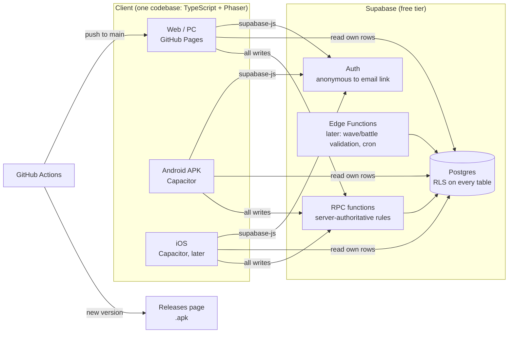
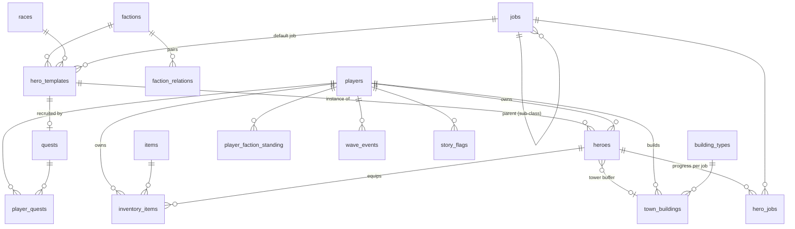

# System Architecture: Aethelgard: Chronos of Fate

Everything here runs on free tiers: GitHub Pages, GitHub Actions, and the Supabase Free plan.

## 1. Overview



| Layer | Choice | Why |
|---|---|---|
| Engine | **Phaser 4** + TypeScript | Mature 2D engine, supports isometric tilemaps (Tiled), WebGL lighting, runs everywhere a browser runs |
| Build | **Vite** | Fast dev server, small production bundles |
| Mobile | **Capacitor** | Wraps the same web build into Android/iOS apps |
| Backend | **Supabase** | Postgres, Auth, Row Level Security, and RPC with no server to maintain |
| Maps | **Tiled** (`.tmj`, isometric) | Free map editor that Phaser loads natively |
| CI/CD | **GitHub Actions** | `ci.yml` (PR build), `pages.yml` (web), `release.yml` (APK to Releases) |

## 2. Core rule: the client draws, the server decides

- **Client-side (real-time):** movement, combat, tower targeting, and wave simulation run in Phaser at 60fps. They can't wait on the network.
- **Server-side (persistent):** resources, build/upgrade timers, job unlocks, quest completion, recruitment, and story flags change only through Postgres RPC functions (`SECURITY DEFINER`). The client can **read** its own rows. It can never `insert`/`update` them directly, except `display_name`.
- **Time-based building** uses the server clock (`now()`) for `timer_ends_at`. Changing the phone's clock does nothing. The client shows a countdown, then calls `finish_timers()`.
- **Generators** store `last_collected_at`. Production is `rate × elapsed`, capped by `storage_cap`, and is computed in `collect_resources()`.
- **Known gap (todo):** quest objective progress and wave results are trusted from the client for now. The plan is an Edge Function that validates a compact battle log (seeded RNG + inputs) before rewarding.

## 3. Database

Migrations (run in order): [`20261019000000_init.sql`](../supabase/migrations/20261019000000_init.sql) and [`20261019010000_items_races_diplomacy.sql`](../supabase/migrations/20261019010000_items_races_diplomacy.sql). Starter content is in [`supabase/seed.sql`](../supabase/seed.sql), which only upserts, so it is safe to re-run after edits.



| Requested table | Where it lives |
|---|---|
| `players` | `players` (resources, town level, story chapter) |
| `heroes` | `hero_templates` (catalog: race, faction, backstory, starter or recruitable) + `heroes` (owned: level, job, assignment) |
| `jobs_and_subclasses` | `jobs` table (tier 1 = job, tier 2 = sub-class via `parent_job_id`) + `jobs_and_subclasses` view |
| `town_buildings` | `building_types` (catalog with per-level stats) + `town_buildings` (placed on the grid) |
| `factions` | `factions` (+ passive buffs, hidden lore), `faction_relations`, `player_faction_standing` |
| `quests` | `quests` (catalog, 4 types) + `player_quests` (status and progress) |
| `inventory_items` | `items` (catalog) + `inventory_items` (stacks; equipped gear has `equipped_by_hero` set) |

**Catalog tables** (public, read-only): `factions`, `faction_relations`, `races`, `jobs`, `hero_templates`, `building_types`, `items`, `quests`.

**Player tables** (only the owner can read them; written through RPC): `players`, `heroes`, `hero_jobs`, `town_buildings`, `inventory_items`, `player_faction_standing`, `player_quests`, `wave_events`, `story_flags`.

How each feature maps to the schema:

| Feature | Tables / functions |
|---|---|
| Starting hero (race, faction, origin) | `hero_templates.is_starter`, `choose_starter()` (also seeds faction standings and starter items) |
| Races with passive buffs | `races.base_stats`, `races.passive_buffs` (Human, Beastkin, Elf, Dwarf, Demonkin) |
| Factions and diplomacy | `factions.passive_buffs`, `faction_relations.base_standing`, `player_faction_standing`; quests can change standing |
| Free job changing + branching sub-classes | `jobs.parent_job_id` / `tier` / `unlock_parent_level`, `hero_jobs` keeps each job's level, `change_job()` |
| Sub-hero roles | `heroes.assignment` (`party` / `commander` / `tower_buffer`), `assign_hero()` |
| Weapons, armor, potions, loot | `items`, `inventory_items`, `equip_item()` (checks the job's allowed weapons), `unequip_item()` |
| Walls / towers / traps / mines / farms / mana extractors | `building_types.category`, per-level stats in `levels` jsonb |
| Time-based upgrades | `town_buildings.timer_*`, `place_building()`, `start_upgrade()`, `finish_timers()` |
| Economy | `players.gold/wood/stone/mana`, `collect_resources()`, item buy/sell prices |
| 4 quest types | `quest_type` enum: `main`, `recruitment`, `guild`, `wave_defense` |
| Night wave attacks | `wave_events.scheduled_at`, `quests.repeat_interval` |
| Mystery / dark twist | `story_flags`, plus `factions.hidden_lore` shown only once `reveal_flag` is set |

RPC errors are raised as plain codes (`NOT_ENOUGH_RESOURCES`, `TILE_OCCUPIED`, `JOB_LOCKED`, `WEAPON_NOT_ALLOWED_FOR_JOB`, `BUSY`, `MAX_LEVEL`, …). Translate them in the UI.

**Security:** internal helpers (`_spend`, `_grant_item`, `_adjust_standing`) have EXECUTE revoked from `anon` and `authenticated`, including Supabase's default grant. Players can only call the listed game RPCs.

## 4. Client structure

```
src/
  main.ts                      Phaser config: RESIZE scale, 3 touch pointers, pixelArt
  core/
    EventBus.ts                global events between scenes and systems
    GameState.ts               runtime state: player stats, controls, inventory, story flags
  iso/
    iso.ts                     grid <-> screen math (2:1 diamond, 64x32 tiles)
    IsoMap.ts                  renders ground and props, collision queries
  world/
    worldData.ts               the starter region: village, roads, river, spawns, NPCs
  entities/
    Actor.ts                   sprite + shadow, depth-sorted by feet position
    Player.ts                  free movement with wall sliding
    Npc.ts                     talkable villager
    Monster.ts                 monster stats + wander / chase AI
  systems/
    combat/CombatSystem.ts     attacks, damage, EXP, level up, loot, respawn
    combat/ClassSystem.ts      race x job x level -> stats (mirrors seed.sql)
    combat/Starters.ts         starter heroes (mirrors hero_templates in seed.sql)
    quest/QuestTracker.ts      quest status and progress, synced to Supabase
    dialogue/DialogueSystem.ts what each NPC says, based on quests and story flags
    building/BuildingManager   (next) grid placement, timers, upgrades
    wave/WaveController        (next) day/night cycle, night waves on the town core
  ui/
    UIScene.ts                 UI handler: status panel, quest tracker, toasts
    VirtualJoystick.ts         floating left-thumb stick
    ActionButton.ts            ATK / TALK buttons
    DialogueBox.ts             typewriter dialogue panel
  services/
    supabase.ts                client + anonymous sign-in (offline mode if not configured)
    api.ts                     typed wrappers for every RPC
  assets/
    textures.ts                procedural placeholder pixel art (swap for real sprites)
  scenes/
    BootScene.ts               textures, sign-in
    StarterScene.ts            choose the starting hero (Kael / Lyra / Rook)
    WorldScene.ts              free-roam field: wires the map, entities and systems
```

Controls: the virtual stick (left thumb) and the ATK/TALK buttons on touch; WASD/arrows, Space, E and Q (potion) on keyboard. Touch controls hide during dialogue, and will hide during base-building mode.

## 5. Art pipeline (rich isometric pixel art)

- Tile size **64×32** (2:1 iso), characters about 32–48px tall, scaled ×2–3 with `pixelArt: true` (nearest-neighbor).
- Maps are built in **Tiled** (isometric orientation) and loaded with `this.load.tilemapTiledJSON`.
- **Dynamic lighting:** Phaser's Light2D pipeline with normal maps for torches and crystals. Add a night tint for wave events.
- **Assets:** CC0/free packs where possible. Rich isometric packs at the level of the reference images are rare for free, so expect to mix CC0 packs with commissioned or AI-assisted sprites. Keep each asset's license in `public/assets/LICENSES.md`.

## 6. Setup

1. Create a free project at [supabase.com](https://supabase.com).
2. In **SQL Editor**, run `supabase/migrations/20261019000000_init.sql`, then `supabase/seed.sql`.
3. **Authentication → Sign In / Providers**: enable **Anonymous sign-ins**.
4. In **Project Settings → API**, copy the Project URL and the `anon` public key.
5. In the GitHub repo, go to **Settings → Secrets and variables → Actions → Variables** and add `VITE_SUPABASE_URL` and `VITE_SUPABASE_ANON_KEY`. The anon key is meant to be public; RLS protects the data.
6. For local dev, copy `.env.example` to `.env.local`, then run `npm install` and `npm run dev`.

Without step 5, the game still builds and runs in **offline mode** (nothing is saved).

## 7. Release flow

- PR → `ci.yml` builds.
- Merge to `main` → `pages.yml` deploys the web version to GitHub Pages.
- Merge to `main` with a new `version` in `package.json` → `release.yml` builds a debug-signed APK and publishes release `v<version>` with the `.apk` attached.

## 8. Free-tier limits to know

- **Supabase Free:** 500 MB database, 50k monthly active users. The project **pauses after 7 days without activity** (un-pause from the dashboard).
- **iOS:** building needs a Mac (or a macOS Actions runner) and a paid Apple Developer account ($99/yr) to install on devices. Android and web are fully free.
- **APK signing:** releases use the debug key, which is fine for sideloading. Google Play requires a release keystore, which would be stored as a GitHub secret.
